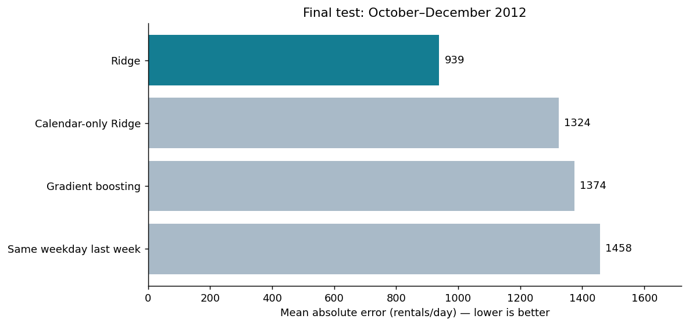

# Tomorrow’s bikes

Can recent rental counts improve a forecast of tomorrow’s bike use? This project
examines that question using daily Capital Bikeshare records from 2011 and 2012.
The forecast combines calendar information with counts from completed days, then
compares its errors with a simple rule: predict the same count as the same weekday
last week.

## Main finding

A Ridge model selected through chronological validation reduced mean absolute
error by **35.6%** on the final 92 test days, from **1,457.59** to **938.97 rentals
per day**. The model handled broad patterns better than the baseline, but still
missed sharp drops during service disruptions and unusual conditions.



Further analysis suggests that recent rental history carries most of the useful
signal. History-only and combined Ridge models performed similarly. An exploratory
block-bootstrap analysis placed the original model’s error reduction between
21.1% and 49.7%, using an approximate 95% interval conditional on the fitted
models and this historical period.

## Project contents

| File | Contents |
|---|---|
| [bike_demand.ipynb](bike_demand.ipynb) | Executed analysis with methods, results, and figures |
| [bike_demand_report.html](bike_demand_report.html) | Self-contained HTML version of the analysis |
| [RESULTS.md](RESULTS.md) | Main findings and their limitations |
| [EXPERIMENT_PLAN.md](EXPERIMENT_PLAN.md) | Design choices fixed before the original evaluation |
| [EXTENSION_PLAN.md](EXTENSION_PLAN.md) | Methods for the later exploratory analyses |
| [EVENT_CONTEXT.md](EVENT_CONTEXT.md) | Sources for the disruption case studies |
| [project.py](project.py) | Data checks, feature engineering, models, and evaluation |
| [extensions.py](extensions.py) | Feature comparisons, bootstrap estimates, and error diagnostics |
| [slides](slides/) | PowerPoint and PDF presentations |
| [docs/presentation_script.md](docs/presentation_script.md) | Presentation transcript |

The `results/` folder contains per-day predictions, validation scores, error
summaries, and charts. The `results/extensions/` folder also includes bootstrap
draws and the results of the exploratory comparisons.

## Reproducibility

The analysis was tested with Python 3.12. From the repository root, the following
commands install the pinned dependencies and execute the notebook:

```sh
python -m pip install -r requirements.txt
python run_project.py
```

`run_project.py` executes all nine code cells in order and regenerates the notebook
outputs, HTML report, figures, and fitted models. It supports the plain Python
cells used in this project. The bundled data allow offline execution without
API keys or a GPU. If the source CSV is absent, the pipeline downloads it from UCI.
The generated model file, `results/fitted_models.joblib`, is excluded from the
repository and recreated during execution.

## Evaluation design

The dataset has 731 daily records. The first 28 days establish the history needed
for lagged features, leaving 611 development days and 92 final test days. Three
expanding validation windows determine model selection before evaluation on
October through December 2012.

Each forecast assumes that the previous day’s complete rental count is available.
Models remain fixed within an evaluation window, while the history updates as
new days finish. Target-day observed weather and the counts that sum to the target
are excluded. Scaling is fitted on training data only.

The later feature comparisons and diagnostics were designed after the original
test had been examined. They are exploratory and leave the original model
selection and predictions unchanged.

## Interpretation and limits

These results describe one historical system and a final test covering autumn
and early winter. They do not establish present-day performance or performance
over a full future year. Recorded rentals also depend on service availability,
so they cannot measure unmet demand or identify shortages at individual stations.

The bootstrap intervals leave out uncertainty from training and model selection.
No financial savings or operational improvements were measured. Archived weather
forecasts and service notices are possible additions for a future study with new
test dates.

## Data and sources

Fanaee-T, H. (2013). *Bike Sharing* [Dataset]. UCI Machine Learning Repository.
https://doi.org/10.24432/C5W894

UCI lists the data under [CC BY 4.0](https://creativecommons.org/licenses/by/4.0/).
The original CSV and source README are preserved in `data/raw/`. The data were
retrieved on November 6, 2026, and their SHA-256 fingerprint appears in
`results/data_audit.json`.

Associated paper: Fanaee-T, H. and Gama, J. (2013). *Event labeling combining
ensemble detectors and background knowledge*.
https://doi.org/10.1007/s13748-013-0040-3
